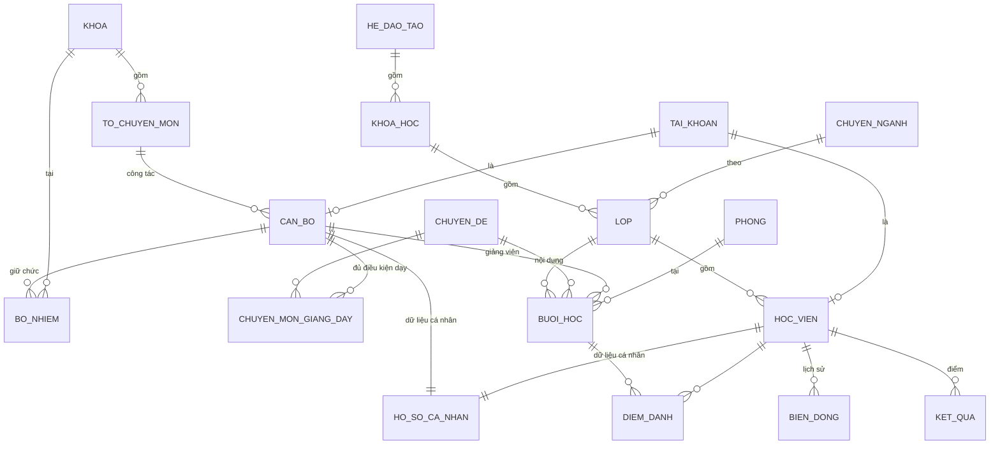

# Thiết kế tổng thể và bối cảnh làm việc: Hệ thống quản lý Khoa/Lớp đào tạo

Học viện An ninh nhân dân. Nhóm 4 người. Hạn 17/11/2026. Tài liệu viết ngày 05/11/2026.
Một tệp duy nhất gồm bối cảnh cho Claude trong VS Code (phần 0) và thiết kế đầy đủ (phần 1 đến 11).

> **Cách dùng.** Lưu tệp này vào `docs/THIET_KE_TONG_THE.md` trong project B. Tạo `CLAUDE.md` ở thư mục gốc,
> chỉ cần một dòng `@docs/THIET_KE_TONG_THE.md` để Claude Code nạp tệp này mỗi phiên. Hoặc lưu thẳng thành `CLAUDE.md`.

---

## 0. Bối cảnh nhanh cho Claude (đọc trước)

- **Dự án:** Hệ thống quản lý Khoa/Lớp đào tạo, Học viện An ninh nhân dân. Dữ liệu mẫu hoàn toàn giả.
- **Nền làm việc:** project B (LTMT-demo), Blazor Web App .NET 8 Interactive Server, Radzen 6.4.0.
  Repo `https://github.com/phmc1810/LTMT-demo.git`, commit mới nhất lúc viết `307cbb9`.
- **Mục tiêu:** hoàn thiện góc nhìn Admin cho ba mảng (Quản lý khoa, Quản lý đào tạo, Quản lý học viên), sau đó bổ sung manager riêng cho từng mảng.
- **Bản mẫu giao diện bấm được** (đích đến về giao diện): https://claude.ai/artifact/8nKqLgBRkbqSHwo8aZeuGC
- **Trang thiết kế gốc:** https://claude.ai/artifact/X6pWLQ8jQZUDLQcHWYtcQU. Cả hai là artifact riêng tư, chỉ mở được khi đăng nhập đúng tài khoản.
- **Quy ước làm việc:** tuân thủ `AGENTS.md` của B (tiếng Việt, từng bước nhỏ, nêu mục tiêu, tệp liên quan và cách kiểm tra trước mỗi bước, chỉ sửa mã khi được yêu cầu rõ). Tiêu chí riêng của chủ dự án nằm ở mục 11.
- **Việc đầu tiên nên làm:** chuyển dữ liệu nghiệp vụ từ bộ nhớ sang CSDL (mục 10, bước 1). Chưa làm bước này thì chưa lưu bền được điểm danh, điểm, lịch.

---

## 1. Tóm tắt các quyết định đã chốt

| # | Quyết định | Nguồn |
|---|---|---|
| 1 | Làm trên project B, không viết lại từ đầu | Nhóm, 05/11 |
| 2 | Tên chính thức: Hệ thống quản lý Khoa/Lớp đào tạo | Biên bản chiều 05/11 |
| 3 | Admin quản lý ba mảng; manager từng mảng bổ sung sau | Biên bản chiều 05/11 |
| 4 | Ba hệ đào tạo: chính quy, liên thông, văn bằng 2. Tập huấn cho cán bộ đã đi làm xem xét sau | Nhóm |
| 5 | Cơ cấu: Khoa → Tổ chuyên môn → Giáo viên | Nhóm |
| 6 | Lớp chính là trung đội. Mã lớp `B10D58` = lớp 10, khoá D58 | Nhóm |
| 7 | Liên thông dùng chung quy ước mã lớp với chính quy và văn bằng 2 | Nhóm |
| 8 | Mỗi tài khoản một vai trò. Ủy quyền khi Admin vắng sẽ thiết kế riêng, làm sau | Nhóm |
| 9 | Có lịch đào tạo, điểm danh, điểm số, phòng học. Hình thức thi làm sau | Nhóm |
| 10 | Dữ liệu mẫu giả như các project trước, không dùng dữ liệu thật | Nhóm |
| 11 | Muốn hoàn chỉnh đủ tính năng như project A; chia hai mốc (mục 9) | Nhóm |

**Còn mở:**
- Học viên có được gõ tên để tìm bạn cùng lớp không (hiện họ tên và lớp)? Tạm đặt: có, bật tắt bằng một cấu hình.
- 17/11 là demo hay nộp sản phẩm, có chấm điểm không? Quyết định mức độ cắt giảm nếu trễ.

---

## 2. Ba dự án gốc và cái được lấy

| Dự án | Điểm mạnh | Điểm yếu | Lấy cho bản tích hợp |
|---|---|---|---|
| **A** (LTMT) | EF Core, Identity, nhập Excel xem trước/xác nhận, nhật ký, sơ đồ tổ chức, test, CI | Giao diện hàng bảng cao; bản tải về cũ hơn bản nhóm đang có | Excel, nhật ký, sơ đồ tổ chức, quy tắc dữ liệu |
| **B** (LTMT-demo) | Giao diện sạch, quy mô dữ liệu thật, nghiệp vụ đào tạo chính quy | Dữ liệu nghiệp vụ nằm trong bộ nhớ; ba vai trò | **Nền chính** |
| **C** (BlazorApp1) | Theo dõi vòng đời học viên: lịch, điểm danh, điểm; quy tắc trả về lý do | Dữ liệu trong bộ nhớ; đăng nhập giả; khoá ngoại bằng tên; hoa văn nền | Logic lịch, điểm danh, điểm, chặn trùng |

---

## 3. Hiện trạng project B (đã build và chạy thử bản sao)

- Sidebar ba nhóm: Quản lý khoa (Danh sách khoa, Tổ chuyên môn, Cán bộ giảng viên), Quản lý đào tạo (Tổng quan, Chuyên ngành, Khoá và niên khoá), Quản lý học viên (Danh sách lớp, Danh sách học viên). Nhóm Hệ thống: Trợ giúp, Quản trị hệ thống (chỉ Admin).
- Thanh trên: breadcrumb, chuông thông báo, bánh răng (Sáng/Tối, Việt/English), menu tài khoản.
- Dữ liệu mẫu sinh theo công thức cố định: 12 khoa (`KH-01` đến `KH-12`), 24 tổ (2 tổ/khoa), 108 cán bộ (9/khoa), 106 lớp (90 chính quy D53 đến D58, 16 văn bằng 2 K3 đến K6), 4.240 học viên (40/lớp).
- Lưu trữ: khoa, tổ, cán bộ, lớp, học viên nằm trong `KhoDuLieuDemo` (singleton danh sách trong bộ nhớ, mất khi tắt). Chỉ tài khoản nằm trong SQLite (`App_Data/tai-khoan.db`).
- Phân quyền hiện có: Admin, Manager (phạm vi Khoa hoặc Lớp), Guest. Kiểm ở `DichVuPhanQuyenDemo` và `DichVuQuanLyDuLieuDemo` trước mỗi thao tác ghi.
- Tài khoản mẫu (chỉ môi trường Development, theo `README.md` của B): `admin`, `quanlykhoa`, `quanlyhocvien`, `nguoixem`.
- Kiểm thử: các chương trình console trong `KiemThu/` gọi trực tiếp lớp dịch vụ.

**Biên bản chiều 05/11, các thay đổi đã làm trong B:**
- Giao diện: font Segoe UI; đăng nhập nền xanh, hộp gọn ở giữa; sidebar cân lại, menu nổi khi rê chuột chỉ xuất hiện lúc thu gọn; Sáng/Tối và Việt/English cho điều hướng và nhãn chung.
- Bảng: căn chỉnh độ rộng, khoảng cách, tăng tương phản; cố định cột thao tác bên phải; nút sửa/xoá khác màu; 5, 10, 20, 30, 40 dòng/trang; tách cấp bậc hàm khỏi chức vụ; bỏ cột trạng thái ở khoa và tài khoản; bỏ tự ẩn cột khi cuộn.
- Luồng: quản lý học viên gộp lớp và học viên, bấm mã lớp xem lớp và học viên; quản lý khoa bấm khoa xem tổ và cán bộ, bấm tổ xem cán bộ; các trang chi tiết dùng tham số đường dẫn và kiểm tra quan hệ khoa–tổ; quản lý đào tạo mới có tổng quan, chuyên ngành, khoá, niên khoá.
- Dữ liệu: chủ nhiệm giả lập dạng cấp bậc hàm + họ tên; niên khoá 4 năm; thông báo ở trang riêng mở bằng chuông; Trợ giúp có hướng dẫn và phản hồi minh hoạ chưa gửi.

---

## 4. Kiến trúc kỹ thuật

- **Một ứng dụng, chia theo module.** Không tách dịch vụ nhỏ, không CQRS.
- **Lớp:** Giao diện Blazor (Radzen) → dịch vụ nghiệp vụ theo module → quy tắc miền (một nơi, trả về lý do) → EF Core.
- **CSDL:** SQLite khi dev/demo, PostgreSQL khi triển khai (EF Core không phụ thuộc nhà cung cấp). Dùng `IDbContextFactory` vì Blazor Server không nên giữ một DbContext cho cả phiên.
- **Đăng nhập:** ASP.NET Core Identity, cookie (B đã có). Thu hồi phiên khi đổi quyền (B đã có).
- **Nhật ký:** ghi tự động ở một điểm (`SaveChanges`) kèm giá trị trước/sau; ghi cả lượt xem dữ liệu cá nhân.
- **Dữ liệu mẫu:** seed ổn định bằng công thức cố định, ghi qua dịch vụ vào CSDL.
- **Kho mã:** `.gitignore` phải loại `bin/`, `obj/`, `.vs/`, `*.db`.
- **Radzen:** B dùng 6.4.0. Khi mang thành phần từ BlazorApp1 (12.1.2) sang, kiểm tra tương thích phiên bản.

---

## 5. Mô hình dữ liệu

Nguyên tắc: mỗi thông tin một nơi; tính thay vì lưu (sĩ số, số buổi vắng, trạng thái); khoá ngoại bằng id, không dùng tên; trạng thái là danh sách cố định.



**Thay đổi so với B hiện tại**
- Khoa, tổ, cán bộ, lớp, học viên chuyển từ danh sách trong bộ nhớ sang bảng thật. Hệ, khoá, chuyên ngành của lớp (hiện là chuỗi) thành bảng `HE_DAO_TAO`, `KHOA_HOC`, `CHUYEN_NGANH`.
- Trưởng khoa, phó khoa, tổ trưởng, tổ phó (hiện là cột cứng `MaTruongKhoa`, `MaPhoKhoa`, `MaPhoKhoaThuHai`...) thành `BO_NHIEM` có từ ngày, đến ngày.
- Dữ liệu cá nhân (CCCD, số hiệu CAND, mã cán bộ, điện thoại, email, địa chỉ, ngày sinh, quê quán) tách sang `HO_SO_CA_NHAN` (một-một). Mặc định truy vấn không nối bảng này.
- Thêm: `CHUYEN_DE`, `CHUYEN_MON_GIANG_DAY`, `PHONG`, `BUOI_HOC`, `DIEM_DANH`, `KET_QUA`, `BIEN_DONG`.

**Quy tắc mã lớp và niên khoá**
- `B{số lớp}{khoá}`: `B10D58`. Chính quy và liên thông: số lớp 1 đến 15, khoá D53 đến D58. Văn bằng 2: `B{số}K{3-6}`.
- Mã lớp **không gõ tay**: sinh từ số lớp và khoá, có chỉ mục duy nhất, báo lỗi nếu trùng.
- Chuyên ngành chính quy suy ra từ số lớp bằng **bảng dữ liệu** (không nằm cứng trong mã): 1 đến 3 Trinh sát an ninh; 4 đến 7 Điều tra hình sự; 8 Quản lý xuất nhập cảnh; 9 đến 12 ANM & PCTPCNC; từ 13 Công nghệ thông tin. Văn bằng 2: số lẻ Điều tra, số chẵn ANM & PCTPCNC (theo dữ liệu hiện có của B).
- Niên khoá 4 năm: `năm nhập học = 2026 + khoá - 58` với chính quy, `2026 + khoá - 6` với văn bằng 2 (hàm `TinhNienKhoa` đã có trong B).

**Quy tắc toàn vẹn**
- CSDL bảo đảm: mã khoa, tổ, cán bộ, lớp, học viên, CCCD là duy nhất; mỗi học viên một dòng điểm danh cho mỗi buổi; mỗi đơn vị tối đa một người giữ chức trưởng đang hiệu lực; không xoá cứng bản ghi đã được tham chiếu (chuyển sang ngừng hoạt động).
- Dịch vụ bảo đảm, **mọi quy tắc trả về lý do**: giảng viên không dạy hai nơi cùng giờ; phòng không bị đặt chồng; sĩ số không vượt sức chứa; phòng thi đủ chỗ; phòng bảo trì không xếp được; điểm tổng kết `= 30% chuyên cần + 70% kiểm tra`, làm tròn 1 chữ số, từ 5.0 là đạt, thiếu điểm thì nói rõ thiếu điểm nào; cổng tự điểm danh mở trước giờ học 30 phút và đóng sau 15 phút.
- Xếp loại: dưới 5.0 Không đạt; 5.0 đến dưới 6.5 Đạt; 6.5 đến dưới 8.0 Khá; 8.0 đến dưới 9.0 Giỏi; 9.0 trở lên Xuất sắc.

---

## 6. Phân quyền

### 6.1 Vai trò

| Vai trò | Phạm vi | Làm được |
|---|---|---|
| **Admin** | Toàn hệ thống | Mọi tác vụ trong ba mảng, tài khoản, nhật ký. Làm trước theo biên bản |
| **Quản lý khoa** | Mảng khoa | Khoa, tổ, cán bộ, chuyên môn giảng dạy. Thấy mảng khác ở mức tổng hợp |
| **Quản lý đào tạo** | Mảng đào tạo | Chuyên ngành, khoá, niên khoá, chuyên đề, lịch, phòng. Thấy cán bộ ở mức tên, học vị, chuyên môn, tổ; thấy lớp ở mức số liệu tổng hợp |
| **Quản lý học viên** | Mảng học viên | Lớp, học viên, điểm danh, điểm. Thấy giảng viên dạy lớp mình ở mức tên và chuyên môn |
| **Giảng viên** | Lớp mình dạy | Điểm danh, nhập điểm cho lớp mình; xem hồ sơ của mình |
| **Học viên** | Phần của mình | Xem lịch, điểm, tự điểm danh trong khung giờ; tìm kiếm ở mức tối thiểu |

Mỗi tài khoản một vai trò. Ba manager thay cho hai Manager (Khoa, Lớp) hiện có của B. Giảng viên và Học viên thay cho Guest (tận dụng đăng ký tài khoản, Admin nâng vai trò).

### 6.2 Ma trận theo nhóm dữ liệu

| Nhóm dữ liệu | Admin | QL khoa | QL đào tạo | QL học viên | Giảng viên | Học viên |
|---|---|---|---|---|---|---|
| Cán bộ: định danh, chuyên môn | Sửa | Sửa | Xem | Xem (GV dạy lớp mình) | Xem | Xem (GV dạy lớp mình) |
| Cán bộ: công tác | Sửa | Sửa | — | — | Của mình | — |
| Cán bộ: cá nhân, liên hệ | Sửa | Sửa | — | — | Của mình | — |
| Chuyên đề, chuyên ngành, khoá, niên khoá | Sửa | Xem | Sửa | Xem | Xem | Xem |
| Lịch, phòng | Sửa | Xem | Sửa | Xem | Lớp mình | Lớp mình |
| Lớp, học viên: danh tính | Sửa | Tổng hợp | Tổng hợp | Sửa | Lớp mình | Tối thiểu |
| Học viên: học vụ (điểm danh, điểm) | Sửa | Tổng hợp | Tổng hợp | Sửa | Nhập, sửa cho lớp mình | Của mình |
| Học viên: cá nhân, liên hệ | Sửa | — | — | Sửa | — | Của mình |
| Tài khoản giảng viên | Sửa | — | Sửa | — | — | — |
| Tài khoản học viên | Sửa | — | — | Sửa | — | — |
| Nhật ký | Xem | — | — | — | — | — |

"Tổng hợp" nghĩa là chỉ số liệu, không thấy từng người. "Tối thiểu" nghĩa là họ tên và lớp.

### 6.3 Bảy hàng rào

1. Mỗi dữ liệu có một chủ. Vai trò khác đọc qua mặt cắt đã định sẵn, không bao giờ qua bản ghi gốc.
2. Quản lý đào tạo và quản lý khoa không xem danh sách, điểm, thông tin cá nhân của từng học viên.
3. Quản lý học viên không xem công tác hay thông tin cá nhân của cán bộ.
4. Giảng viên chỉ thấy lớp mình dạy; không thấy CCCD, điện thoại, địa chỉ học viên; không thấy thông tin cá nhân đồng nghiệp.
5. Học viên chỉ thấy phần của mình; tìm kiếm chỉ trả họ tên và lớp.
6. Cấp tài khoản chỉ đi xuống: Admin tạo manager; Quản lý đào tạo cấp tài khoản giảng viên; Quản lý học viên cấp tài khoản học viên. Không ai cấp vai trò ngang hoặc cao hơn mình.
7. Nhật ký chỉ thêm, không ai sửa hoặc xoá được, kể cả Admin. Mọi thao tác Admin có mục riêng.

### 6.4 Giữ ranh giới ở mức từng trường (bắt buộc)

Ẩn một cột trên giao diện **không phải là bảo vệ**, vì dữ liệu vẫn nằm trong phản hồi.
- Mỗi trường thuộc một nhóm (`canbo.dinhdanh`, `canbo.congtac`, `canbo.canhan`, `hocvien.dinhdanh`, `hocvien.hocvu`, `hocvien.canhan`). Quyền gắn với nhóm trường.
- Dịch vụ **không trả thực thể gốc**. Mỗi vai trò nhận một đối tượng riêng (ví dụ `CanBoCongKhai`, `CanBoDayDu`). Truy vấn chỉ chọn cột được phép.
- Form sửa nhận đối tượng theo nhóm trường mà vai trò được sửa. Gửi thêm trường ngoài nhóm thì bị bỏ qua và ghi nhật ký.
- Xuất Excel và in ấn dùng đúng mặt cắt của màn hình.
- **Test sinh từ ma trận:** với mỗi cặp (vai trò, nhóm trường), kiểm tra JSON và tệp xuất không chứa trường bị cấm.
- Dữ liệu cá nhân mặc định hiển thị dạng che (ví dụ `079•••••••123`). "Hiện đủ" ghi nhật ký: ai xem, xem ai, lúc nào.

### 6.5 Ủy quyền khi Admin vắng

- **Mốc 1:** dùng hai tài khoản Admin (một dự phòng, cất kỹ).
- **Mốc 2:** ủy quyền hẹp có thời hạn. Không uỷ quyền toàn quyền, không uỷ quyền tạo Admin, không nới phạm vi dữ liệu (Quản lý đào tạo được uỷ quyền cấp tài khoản vẫn không xem được học viên), người nhận không uỷ quyền tiếp, mọi thao tác ghi "theo uỷ quyền của X", tự hết hạn, thu hồi được bất cứ lúc nào.
- Các khả năng khác để Mốc 2: chốt và mở khoá điểm, duyệt hai bước thao tác nhạy cảm, Admin xem như vai trò khác (chỉ đọc, có ghi nhật ký).

---

## 7. Tích hợp A và C vào B: mỗi chức năng một chỗ

Không thêm mục menu mới. Trong trang lớp có bốn tab (học viên, lịch, điểm danh, điểm). Quản lý đào tạo thêm tab Chuyên đề và Lịch đào tạo.

| Khối | Chức năng | Nguồn | Đặt ở | Mốc |
|---|---|---|---|---|
| Quản lý khoa | Sơ đồ tổ chức dạng cây | A | Tab "Sơ đồ tổ chức" ở Danh sách khoa | Nên có |
| Quản lý khoa | Nhóm "Cần xử lý" (thiếu CCCD, điện thoại) kèm số lượng | A | Nút lọc trên Cán bộ và Học viên, dẫn từ trang chủ | 1 |
| Quản lý khoa | Hồ sơ chia nhóm trường, che dữ liệu cá nhân, "Hiện đủ" ghi nhật ký | B, A | Hộp thoại hồ sơ cán bộ | 1 |
| Quản lý khoa | Chuyên môn giảng dạy của từng cán bộ | mới | Cột Chuyên môn, hộp thoại hồ sơ | 1 |
| Quản lý khoa | Nhập, xuất Excel có xem trước | A | Nút trên các danh sách | 2 |
| Quản lý đào tạo | Chuyên đề kèm số giáo viên đủ điều kiện dạy | mới | Tab Chuyên ngành và chuyên đề | 1 |
| Quản lý đào tạo | Lịch tuần, phòng, chặn trùng giờ giáo viên và phòng | C | Tab Lịch đào tạo | 1 |
| Quản lý đào tạo | Kỳ thi, hình thức thi, phòng thi đủ chỗ | C | Tab Lịch đào tạo | 2 |
| Quản lý học viên | Mã lớp tự sinh, niên khoá tự tính, chặn trùng | B, A | Biểu mẫu Thêm lớp | 1 |
| Quản lý học viên | Điểm danh theo buổi, học viên tự điểm danh trong khung giờ | C | Tab Điểm danh trong trang lớp | 1 |
| Quản lý học viên | Điểm 30/70, xếp loại, nói rõ thiếu điểm nào | C | Tab Điểm trong trang lớp | 1 |
| Quản lý học viên | Chứng chỉ, học liệu và duyệt | C | Gắn với hệ tập huấn sau | 2 |
| Hệ thống | Thông báo hành chính: số ký hiệu, mức độ, nơi nhận, đã đọc | A | Trang riêng mở bằng chuông (B đã tách) | 1 |
| Hệ thống | Nhật ký thao tác có giá trị cũ → mới | A | Quản trị hệ thống, tab Nhật ký | 1 |
| Hệ thống | Tìm kiếm Ctrl+K, kết quả theo quyền | mới | Nút tìm kiếm trên thanh trên | 1 |
| Hệ thống | Ủy quyền hẹp có thời hạn | mới | Quản trị hệ thống | 2 |

**Không đưa vào:** bảng tính "Dữ liệu & danh mục" của bản v5 (B sửa bằng biểu mẫu trên trang danh sách), menu 14 mục, hoa văn nền và banner của BlazorApp1, hai bảng riêng cho học viên và giảng viên.

**Còn thiếu so với "hoàn chỉnh như project A" (Mốc 2):** quản trị dữ liệu và trường mở rộng, API REST và Swagger (tuỳ chọn), CI, Docker, tập huấn cho cán bộ đã đi làm, PostgreSQL.

---

## 8. Giao diện

### 8.1 Cấu trúc trang (theo B)
- Sidebar tối: logo và tên học viện, nhóm Nghiệp vụ (ba mảng, mỗi mảng mở ra các mục con), nhóm Hệ thống (Trợ giúp, Quản trị).
- Thanh trên: nút thu gọn, breadcrumb, tìm kiếm, chuông (có số chưa đọc), bánh răng (Sáng/Tối, Việt/English), menu tài khoản.
- Trang chủ: banner chào, thẻ số liệu (Khoa, Tổ, Cán bộ, Lớp, Học viên; bấm được), biểu đồ cơ cấu học viên và lớp theo chuyên ngành, "Cần chú ý" dẫn thẳng tới đúng nhóm cần xử lý, hoạt động gần đây.
- Trang danh sách: tiêu đề + mô tả + nút chính bên phải; thanh tìm kiếm và bộ lọc; dòng "Hiển thị x / y bản ghi"; bảng; chọn số dòng và phân trang.
- Trang chi tiết (khoa, tổ, lớp): breadcrumb, thẻ thông tin, tab con.

### 8.2 Nguyên tắc bố cục
1. Dữ liệu trước: ít nhất 70% chiều cao màn 1366×768 cho vùng làm việc.
2. Một vùng cuộn: tiêu đề cột và thanh công cụ dính, không cuộn lồng nhau.
3. Mật độ bảng vừa phải, thấy ít nhất 12 dòng không cuộn ở 1366×768 với 10 dòng/trang đủ thoáng.
4. Trang trí chỉ ở màn đăng nhập và banner trang chủ; vùng dữ liệu nền phẳng.
5. Mỗi màn hình có đủ bốn trạng thái: có dữ liệu, trống, đang tải (khung xương), lỗi (có nút Thử lại).
6. Lỗi nằm cạnh ô, nói rõ cách sửa ("Chưa đủ chữ số (11/12). CCCD gồm đúng 12 chữ số.").
7. Xoá có xem trước ảnh hưởng ("Khoa còn 2 tổ và 9 cán bộ. Không thể xoá, có thể chuyển sang ngừng hoạt động").
8. Kiểm tra ở 1366×768, 1536×864, 1920×1080 và máy tính bảng, không phải zoom.

### 8.3 Bảng màu (xấp xỉ theo bản mẫu, **đối chiếu với `wwwroot/app.css` của B trước khi dùng**)

| Biến | Sáng | Dùng cho |
|---|---|---|
| Thanh bên | `#0D2B20` | Nền sidebar |
| Chính | `#2E6A4D` | Nút chính, mục đang chọn |
| Banner | `#1D4A37` | Banner trang chủ |
| Nhấn vàng | `#D9B04A` | Chữ nhỏ trên banner, vòng logo |
| Nền ứng dụng | `#F3F6F4` | Vùng nội dung |
| Thẻ | `#FFFFFF` | Thẻ, bảng, hộp thoại |
| Tiêu đề cột | `#E3EEE6` | Hàng tiêu đề bảng |
| Chữ | `#12251B` / `#2B3B32` / `#5D6E64` | Tiêu đề / nội dung / phụ |
| Trạng thái | ok `#166534`/`#DCFCE7`, cảnh báo `#92400E`/`#FEF3C7`, lỗi `#B91C1C`/`#FEE2E2`, thông tin `#1E40AF`/`#DBEAFE` | Thẻ trạng thái |

Chế độ tối đảo nền sang `#0E1A14`, thẻ `#15251D`; chữ sáng; giữ cùng tên biến. Các cặp chữ-nền ở bảng trạng thái đã đo đạt tỷ lệ tương phản từ 4.5.

### 8.4 Hiệu ứng (yêu cầu của chủ dự án: sáng tạo cao, tỉ mỉ đến cùng)
Gợi ý, thực hiện từng lát nhỏ rồi chạy thử:
- Chuyển trang: mờ dần + dịch nhẹ 8 đến 12px, 180 đến 220ms.
- Thẻ số liệu: số chạy lên khi vào trang; nâng nhẹ khi rê chuột; mũi tên dịch chuyển.
- Biểu đồ: cột mọc lên lần lượt khi cuộn tới, giữ dữ liệu đúng ngay cả khi tắt hiệu ứng.
- Bảng: hàng vào theo lớp nhẹ; hàng rê chuột sáng lên; cột thao tác nổi bóng khi cuộn ngang.
- Sidebar: thu gọn mượt; nhóm mở bằng chiều cao; mục đang chọn trượt nền.
- Khung xương khi tải; thông báo và hộp thoại vào bằng chuyển động ngắn.
- Chuông: rung nhẹ khi có thông báo mới. Sáng/Tối chuyển màu mượt.
- **Ràng buộc:** chỉ dùng `transform` và `opacity`; tôn trọng `prefers-reduced-motion`; không làm giật bảng 106 lớp hay 4.240 học viên (phân trang, không dựng tất cả dòng); đẹp ở cả Sáng và Tối; giữ tương phản chữ; có thể focus bằng bàn phím với vòng focus rõ.

---

## 9. Kế hoạch

### 9.1 Hai mốc
- **Mốc 1 (17/11):** Admin xem và sửa đủ ba mảng trên dữ liệu bền; phân quyền theo ba manager, Giảng viên, Học viên với mặt cắt dữ liệu và test; lịch, phòng, chặn trùng; điểm danh, điểm; Thêm lớp mã tự sinh; tìm kiếm; thông báo; nhật ký.
- **Mốc 2 (sau 17/11, ước lượng 5 đến 6 tuần):** tập huấn, bồi dưỡng; chứng chỉ, học liệu; kỳ thi và hình thức thi; sơ đồ tổ chức; Excel; ủy quyền; PostgreSQL, Docker.
- **Phương án B (nếu 17/11 là hạn cứng cho bản đủ tính năng):** đủ mọi module nhưng mỏng, mặt cắt phân quyền chỉ ở bảng chính, nhiều lỗi dự kiến. Rủi ro nằm ở phân quyền.

### 9.2 Bốn luồng việc

| Người | Phụ trách |
|---|---|
| 1 | **Dữ liệu bền.** Chuyển `KhoDuLieuDemo` sang EF Core SQLite, migration, seed giữ công thức cố định, thêm thực thể mới |
| 2 | **Phân quyền và nhật ký.** Ba mảng, Giảng viên, Học viên, mặt cắt, che dữ liệu cá nhân, nhật ký tự động, test sinh từ ma trận |
| 3 | **Mảng đào tạo.** Chuyên ngành, chuyên đề, lịch, phòng, chặn trùng (logic từ BlazorApp1) |
| 4 | **Mảng học viên và giao diện.** Trang lớp bốn tab, điểm danh, điểm, biểu mẫu Thêm lớp, hiệu ứng và bảng chung |

### 9.3 Lịch từng ngày

| Ngày | Việc chính | Xong khi |
|---|---|---|
| T5 – T6 05 – 06/11 | Chốt thiết kế. Tạo nhánh tích hợp từ B. Người 1 bắt đầu EF Core; người 2 liệt kê quyền; người 3, 4 chép logic cần dùng từ BlazorApp1 | Nhánh chạy được. Danh sách quyền và thực thể mới được đồng ý |
| T7 – CN 07 – 08/11 | Làm nhẹ hoặc nghỉ. Người 1 hoàn tất migration và seed bền | Khởi động lại ứng dụng, dữ liệu còn nguyên |
| T2 – T3 09 – 10/11 | Người 2 phân quyền; người 3 lịch, phòng; người 4 trang lớp bốn tab | Mốc giữa kỳ 10/11: Admin xem đủ ba mảng, trang lớp mở được bốn tab |
| T4 – T5 11 – 12/11 | Chặn trùng lịch và phòng; điểm danh, tự điểm danh; điểm, xếp loại; mặt cắt và test | Giảng viên điểm danh và nhập điểm cho lớp mình; học viên thấy phần của mình |
| T6 – CN 13 – 15/11 | Thêm lớp mã tự sinh; Ctrl+K; nhật ký; trang chủ theo vai trò; nếu kịp sơ đồ tổ chức, Excel. Hợp nhất, test. **Đóng băng tính năng tối Chủ nhật** | Test xanh, không còn tính năng mới |
| T2 16/11 | Sửa lỗi, kịch bản demo, tài liệu chạy, video dự phòng | Chạy trọn kịch bản trên máy sạch |
| T3 17/11 | Demo | |

Mỗi tối tích hợp vào nhánh chính và phải chạy được. Nếu trễ ở mốc giữa kỳ, cắt điểm số khỏi Mốc 1 trước.

---

## 10. Việc kỹ thuật theo thứ tự

1. **Lưu dữ liệu nghiệp vụ vào CSDL.** Thay `KhoDuLieuDemo` bằng EF Core SQLite, giữ công thức seed (12/24/108/106/4.240). **Chạy lại `KiemThu/`** để chứng minh hành vi cũ không đổi.
2. **Thêm thực thể:** chuyên đề, phòng, buổi học, điểm danh, kết quả, tách `HO_SO_CA_NHAN`, `BO_NHIEM`. Khoá ngoại bằng id.
3. **Phân quyền ba mảng + Giảng viên + Học viên**, mặt cắt dữ liệu, nhật ký tự động, tài khoản mẫu mới.
4. **Dịch vụ lịch, điểm danh, điểm** (chặn trùng, cổng tự điểm danh, xếp loại có lý do).
5. **Hoàn thiện:** Thêm lớp mã tự sinh, Ctrl+K, sơ đồ tổ chức, Excel.

---

## 11. Tiêu chí hoàn thành, rủi ro, quy trình

**Tiêu chí hoàn thành chung cho mỗi lát việc**
- Chạy được từ máy sạch (`start.cmd`).
- Có test hoặc kịch bản kiểm tra; `KiemThu/` vẫn qua.
- Quyền được kiểm ở lớp dịch vụ, không chỉ ở giao diện; vai trò không có quyền không nhận trường bị cấm.
- Đủ bốn trạng thái màn hình, đẹp ở Sáng và Tối, dùng được ở 1366×768.
- Không dữ liệu cá nhân thật; bí mật ở User Secrets.

**Rủi ro chính**

| Rủi ro | Cách giảm |
|---|---|
| 12 ngày quá ngắn cho mô hình, quyền và giao diện | Chốt mức Mốc 1 sớm; mang logic từ C thay vì viết lại; đóng băng tối 15/11 |
| Đổi schema giữa chừng làm vỡ việc người khác | Chốt schema trước 06/11; đổi phải báo cả nhóm và có migration |
| Hai người sửa cùng tệp | Chia theo mảng; tích hợp mỗi tối |
| Radzen 6.4.0 và 12.1.2 khác phiên bản | Kiểm tra khi mang thành phần từ C sang |
| SQLite ghi tuần tự khi nhiều người nhập cùng lúc | Đủ cho demo; PostgreSQL khi triển khai |

**Quy trình và quy chuẩn của chủ dự án (điền vào, Claude sẽ đối chiếu sau mỗi bước):**

```
(dán hướng dẫn, quy trình, quy chuẩn, tiêu chí của bạn ở đây)
```
